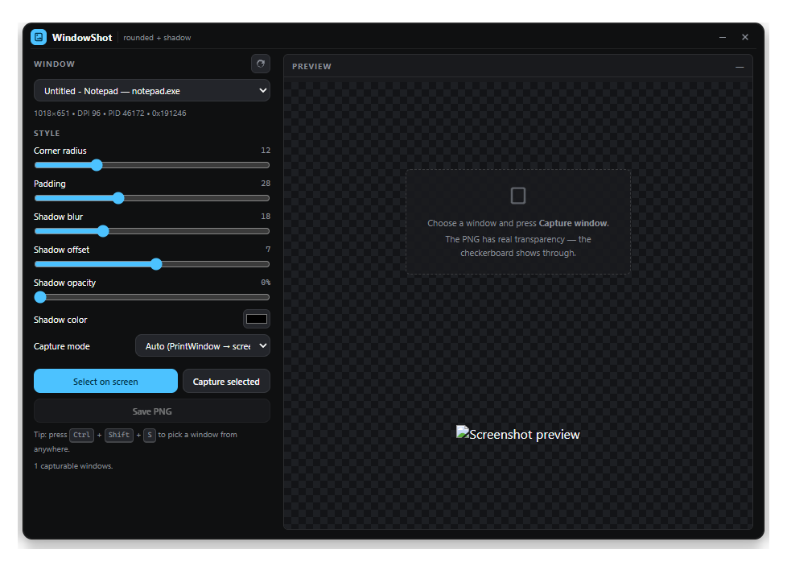
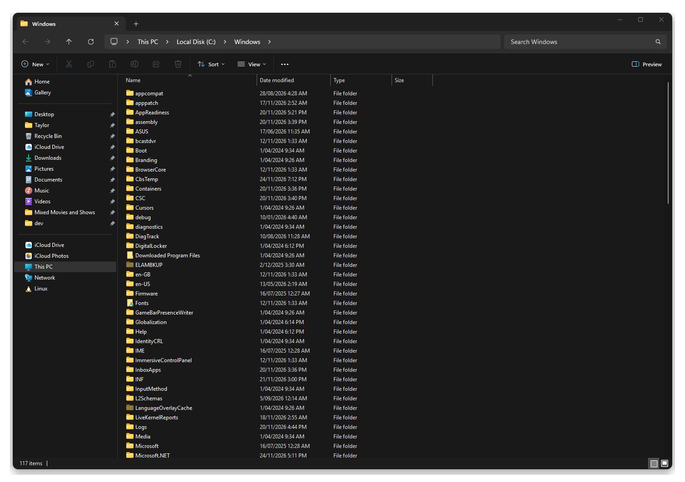

# WindowShot - Apple-style Window Screenshots for Windows

[](https://github.com/taylorivanoff/window-shot/releases)
[](https://github.com/taylorivanoff/window-shot/releases)
[](LICENSE)

WindowShot is an open-source Windows utility that screenshots any visible window and exports a transparent PNG with Apple-style rounded corners, a real alpha cutout, and a soft drop shadow. It uses a Tauri 2 desktop UI with a Rust Win32 capture and rendering core.

Ideal for READMEs, documentation, marketing pages, and social posts where you want a clean macOS-style window instead of a rectangle pasted from the Windows clipboard.





## Features

- **Apple-style cutout** - antialiased rounded corners with transparent padding
- **Soft drop shadow** - adjustable blur, offset, opacity, and color
- **Live preview** - tune radius, padding, and shadow while you work
- **Capture modes** - `Auto`, `PrintWindow`, or screen-region capture for GPU-heavy apps
- **DPI-aware** - style values scale to the target window's DPI
- **Window picker** - refresh and select from all capturable windows
- **Native save dialog** - choose where each PNG is written
- **Tauri tray scaffold** - built with the same framework, styles, and tray base as CmdDeck

## Installation

### Windows

1. Download the latest installer from [Releases](https://github.com/taylorivanoff/window-shot/releases)
2. Run the installer and follow the prompts
3. Launch **WindowShot** from the Start menu

WindowShot currently requires Windows because capture uses Win32 APIs directly.

### From source

See [Development](#development).

## Development

```bash
npm install
npm run dev
```

This syncs the shared styles, starts the local renderer, and launches the Tauri app in development mode.

### Linting

```bash
npm run lint
```

## Building

```bash
npm run build
```

The Windows NSIS installer is written to `src-tauri/target/release/bundle/nsis/`.

## Usage

1. Click **Refresh** to list open windows
2. Select the window you want to capture
3. Adjust corner radius, padding, and shadow settings
4. Click **Capture window** (or press `Ctrl+Enter`)
5. Click **Save PNG** and choose a destination

### Capture modes

- **Auto** - try `PrintWindow` first, then fall back to a screen-region grab if the frame is blank
- **PrintWindow** - capture background or occluded windows where supported
- **Screen region** - most accurate colors, but the target window must be unobscured

## How it works

WindowShot calls `PrintWindow` with `PW_RENDERFULLCONTENT`, crops the result to the DWM extended frame bounds, applies a signed-distance rounded-corner alpha mask, blurs the shadow into the transparent canvas, and writes the final PNG through the `image` crate. If `PrintWindow` returns a flat frame, `Auto` falls back to `BitBlt` from the screen device context.

## Releasing

1. Bump the version in `package.json`, `src-tauri/tauri.conf.json`, and `src-tauri/Cargo.toml`
2. Replace the placeholder updater key in `src-tauri/tauri.conf.json` with your own Minisign public key
3. Run `npm run build`
4. Upload the NSIS installer from `src-tauri/target/release/bundle/nsis/` to a new GitHub Release

## Keywords

Apple-style window screenshot, transparent PNG, rounded corners, drop shadow, Win32 PrintWindow, window capture utility, Tauri desktop app, Rust Windows app

## Contributing

Contributions are welcome! Please feel free to submit a Pull Request.

## License

MIT
